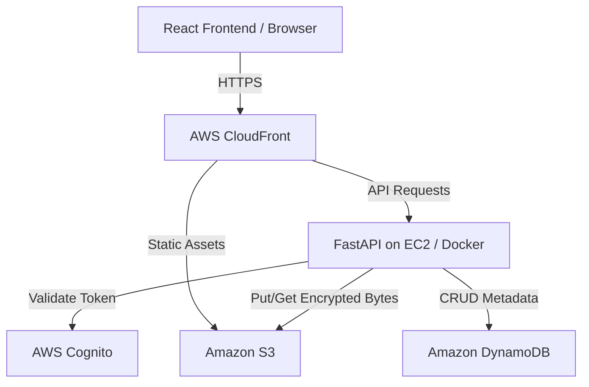

# CloudMediaVault

CloudMediaVault is a full-stack cloud storage application that allows users to securely upload, manage, and stream personal media and documents. It provides application-layer security by encrypting files in memory before cloud storage and decrypting them on the fly for in-browser streaming. The system utilizes automated cloud infrastructure to ensure fast, reliable access and continuous deployment without manual intervention.

## Architecture and End-to-End Workflow

**End-to-End File Workflow:**
1. **Authentication:** User authenticates via AWS Cognito. The backend issues `HttpOnly`, `Secure` cookies containing JWTs and a Fernet-encrypted username.
2. **Upload & Limit Check:** User uploads a file. FastAPI middleware checks `Content-Length` against a strict 100MB limit. 
3. **Encryption:** The backend reads the bytes into memory and uses PBKDF2 (600,000 iterations) to derive a user-specific key, then encrypts the payload using AES-GCM.
4. **Storage & Metadata:** `boto3` synchronously uploads the encrypted bytes to S3. Simultaneously, it writes metadata (S3 key, SHA256 hash, file size, Base64-encoded original filename) to a DynamoDB single-table.
5. **Streaming / Retrieval:** A `GET` request retrieves the encrypted S3 object, decrypts it in memory, and serves a FastAPI `StreamingResponse`. It explicitly supports HTTP `Range` headers to allow partial byte streaming (video scrubbing/seeking).

## Technology Stack

- **Frontend:** React 19 (Vite), Tailwind CSS 4, Zustand. Hosted globally via AWS S3 and CloudFront.
- **Backend:** Python 3.11 with FastAPI, rate limiting via `slowapi`, containerized via Docker and Docker Compose.
- **Data & Storage:** AWS S3 for binary storage, AWS DynamoDB for metadata.
- **Identity:** AWS Cognito for authentication.
- **CI/CD:** GitHub Actions.

## Key Features

- **XSS-Resistant Authentication:** Stateless JWT authentication converted into XSS-resistant HTTP-Only cookies.
- **Application-Layer Encryption:** AES-GCM file encryption and decryption. The key is derived securely combining the user's Cognito `sub`, a master key, and a static salt via PBKDF2HMAC.
- **Video & Document Streaming:** Native support for HTTP Range requests enabling seamless video scrubbing.
- **Efficient Pagination:** Custom pagination handling for DynamoDB single-table queries.
- **Automated Deployments:** 
  - **Frontend:** GitHub Actions builds via Vite, syncs to S3, and triggers a CloudFront invalidation.
  - **Backend:** Uses AWS OpenID Connect (OIDC) to securely trigger AWS Systems Manager (SSM) which rebuilds the Docker container on the target EC2 instance.
